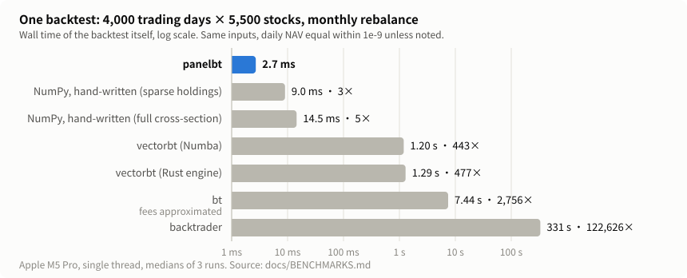
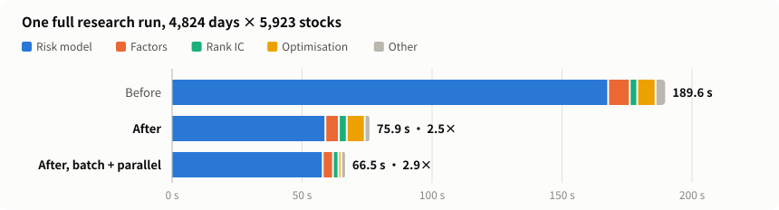

# AShare

A research framework for China A-share equities. Backtesting, factor operators, risk models, portfolio optimisation and paper trading run on Rust kernels behind plain NumPy arrays, with the exchange rules (T+1, price limits, suspensions, board lots, dividends and splits, delisting) built in.

[中文](README.md)

Every number below comes from a record in this repository and can be re-run. The machine is an Apple M5 Pro laptop.

## Why this one

### A full-market backtest in milliseconds



4,000 trading days × 5,500 stocks, about 100 holdings, proportional commission. Each engine receives the same inputs; daily NAV agrees within 1e-9 unless marked.

| Engine | Monthly rebalance | With board lots and cash scaling | Daily rebalance |
|---|---:|---:|---:|
| **panelbt** (this repo) | **2.7 ms** | **2.5 ms** | **27.6 ms** |
| NumPy, hand-written day loop, sparse holdings | 9.0 ms | 8.0 ms | 80.7 ms |
| NumPy, hand-written day loop, full cross-section | 14.5 ms | 14.2 ms | 191 ms |
| vectorbt (Numba) | 1.20 s | 0.99 s | 2.82 s |
| vectorbt (Rust engine) | 1.29 s | — | 1.70 s |
| bt | 7.4 s ¹ | 3.6 s | 44.8 s ¹ |
| backtrader | 331 s | 278 s | 336 s |

¹ fees approximated by the engine's allocation model. — means the engine could not run that scenario.

- `panelbt` checks every input cell by default (non-finite prices, inconsistent masks, bad targets). The hand-written NumPy loops above check nothing. With the same checks on both sides, a full run is 8.0 ms against 14.8 ms.
- Peak memory in the first scenario, including about 0.45 GB of input panels: `panelbt` 0.46 GB, bt 2.6 GB, backtrader 2.9 GB, vectorbt 6.6–8.2 GB.
- The complete A-share rule set (price limits, suspensions, T+1, minimum commission, dividends and splits with tax, delisting, unfilled orders carried forward) runs in about 1.7 ms on the same panel, or 3.5 ms with an index-futures hedge leg. The third-party engines above cannot express that rule set, so there is no like-for-like number for it.

### Factor operators faster than bottleneck, single-threaded

68 time-series, cross-sectional and element-wise operators on a 4,000 × 5,500 panel (window 20, 5% missing). Milliseconds, lower is better; bold marks the fastest single-threaded result and the fastest overall.

| Operator | panelops, 1 thread | panelops, all cores | bottleneck | NumPy | Polars, all cores | pandas |
|---|---:|---:|---:|---:|---:|---:|
| `ts_rank` | **119** | **19** | 1,221 | 906 | 320 | 2,472 |
| `ts_min` | **80** | **15** | 174 | 415 | 116 | 353 |
| `ts_std` | 80 | **16** | **76** | 457 | 113 | 307 |
| `ts_corr` | **339** | **40** | 524 | 703 | 298 | 456 |
| `ts_median` | **467** | **61** | 558 | 2,930 | 297 | 2,456 |
| `cs_rank` | **265** | **27** | 891 | 1,135 | 296 | 1,250 |
| `cs_neutralize` | **312** | **46** | — | 3,396 | — | — |
| `rank_ic` | **517** | **56** | 1,846 | 2,381 | 645 | 2,878 |

- On one thread `panelops` is the fastest of NumPy, bottleneck and single-threaded Polars for 67 of the 68 operators, and within 10% for the last one.
- With default threads it beats every library's default configuration on all 68.
- Rolling sums, means and variances are checked against an exact rational-arithmetic reference; the precision safeguards cost a few percent and are not removed for speed.

### A whole research run in about a minute



One run on real data (4,824 trading days × 5,923 stocks): evaluate 95 factors and their rank ICs, test the best one, rebuild a full-history fundamental risk model, optimise 61 month-end portfolios against it, and backtest the result under the full A-share rules.

| | Total | 95 factors | Rank IC | Risk model | 61 optimisations |
|---|---:|---:|---:|---:|---:|
| Before the optimisation round | 189.6 s | 8.3 | 2.9 | 168.1 | 7.0 |
| After, same calls | 75.9 s | 5.2 | 3.0 | 59.3 | 6.9 |
| After, batch and parallel entry points | 66.5 s | 3.9 | 2.1 | 58.3 | 1.1 |

The round changed 13 things, one commit each, and none of them was allowed to change results:

- 10 are bitwise identical to the code they replace. With the risk model's incremental specific-risk update switched off, the whole run reproduces the earlier output bit for bit.
- The incremental specific-risk update is the one change with a tolerance: 1e-12 relative to the from-scratch computation, measured at 1.5e-14 and checked against a 50-digit reference.
- Solving independent periods in parallel reaches equally optimal but not bitwise-equal weights, so it is opt-in and the default stays serial. That is the only difference between the last two rows' results.
- One attempt brought no measurable gain and was withdrawn; it is recorded next to the ones that worked.

### Where it is not faster

- 1,000 small backtests (1,000 days × 100 stocks, 15 threads): `panelbt` 56 ms, a whole-block NumPy approximation 53 ms. The Rust kernel pays off at full-market size and with real trading rules, not on small panels.
- A simplified futures-hedge task: hand-written NumPy 0.56 ms, `panelbt` 1.0 ms.
- `ts_std` on one thread is 6% behind bottleneck.
- Risk-model cross-sectional regression on one thread: a NumPy Gram solve takes 3.0 s, the Rust kernel 5.0 s. Rust wins with threads (0.64 s on 15).
- A single portfolio solve is the same Clarabel solver whichever way it is called; the kernel adds nothing there.

### How the numbers are kept honest

- 1,395 tests. The backtest kernel is cross-checked against a structurally independent pure-Python reference and an independent ledger on tens of thousands of random scenarios.
- Corporate actions in the data layer are reconciled against exchange adjustment factors over the whole history: 53,487 events, 0 failures.
- Each piece of work was reviewed by an independent pass that tried to break it (copies, adversarial inputs, mutation checks), and the findings were fixed before merging.

## What is inside

| Package | What it does |
|---|---|
| [`panelbt`](packages/panelbt/) | Daily portfolio backtest kernel: target weights or shares in, NAV, trades and diagnostics out. Market-agnostic, with an A-share profile. |
| [`panelops`](packages/panelops/) | Panel operators for factor research and factor tests (IC, group returns, turnover). |
| [`portopt`](packages/portopt/) | Risk-model kernels and conic solver bindings. |
| [`paperbroker`](packages/paperbroker/) | Deterministic paper-trading engine: orders, matching, accounts, settlement. |
| [`src/ashare`](src/ashare/) | The research layer: Tushare data store and point-in-time panel, factor expressions and cache, fundamental risk model, portfolio construction, backtest reports, paper trading. |

The four packages depend only on NumPy and do not import `ashare`. Design notes are in [docs/DESIGN.md](docs/DESIGN.md) (Chinese).

## Quick start

Requirements: Python 3.13, [uv](https://docs.astral.sh/uv/), a stable Rust toolchain.

```bash
make dev      # build the Rust extensions into the workspace environment
make check    # lint and the full test suite
```

A backtest:

```python
import numpy as np
import panelbt as bt

prices = np.array([[10.0, 20.0], [11.0, 19.0], [12.0, 21.0]])
market = bt.Market(prices, prices, prices > 0, prices > 0)
targets = bt.Targets.from_dense([[0.5, 0.5], [np.nan, np.nan], [0, 0]])
costs = bt.Costs(commission_rate=0, commission_min=0,
                 fee_rate_buy=0, fee_rate_sell=0, slippage=0)
config = bt.Config(initial_cash=1000, min_qty=0, qty_step=0)
bt.run(market, targets, costs, config).nav      # [1.0, 1.025, 1.125]
```

A factor and its rank IC:

```python
import numpy as np
import panelops

rng = np.random.default_rng(0)
close = 10 * np.exp(np.cumsum(rng.normal(0, 0.02, (500, 300)), axis=0))  # days × stocks
ret = close[1:] / close[:-1] - 1
momentum = panelops.cs_rank(panelops.ts_mean(ret, window=20))
forward = np.vstack([ret[1:], np.full((1, 300), np.nan)])                # next-day return
ic = panelops.rank_ic(momentum, forward)                                 # one value per day
```

A report after a backtest (a self-contained HTML file that opens offline and prints to A4; needs `Config(record_trades=True)`; the page is in Chinese):

```python
import ashare.data, ashare.report

ashare.report.tearsheet(result, market, targets, dates, symbols,
                        data=ashare.data.open(), benchmark="000300.SH",
                        benchmark_kind="price").save("report.html")
```

For terminals and AI agents, `print(ts)` prints a one-screen plain-text summary; after `ts.save_json("report.json")`, `python -m ashare.report show report.json --section yearly --lang en` shows any section with JSON-key headers. Metric definitions are in [docs/REPORT_NOTES.md](docs/REPORT_NOTES.md) (Chinese).

Targets execute on the row they are given: the engine never shifts signals. Aligning signal dates with execution dates is done once, in `ashare` (`ashare.backtest.execution_targets`).

## Data

No market data is included. The data layer downloads from [Tushare](https://tushare.pro) with your own token, read from the `TUSHARE_TOKEN` environment variable, and stores everything under `data/`, which is not tracked. Tushare data is subject to Tushare's terms and is not redistributed here.

## Status

Early and moving fast: interfaces may change, and nothing has been published to PyPI yet. This is research software. It does not place real orders, and nothing in it is investment advice.

## License

[Apache-2.0](LICENSE).
