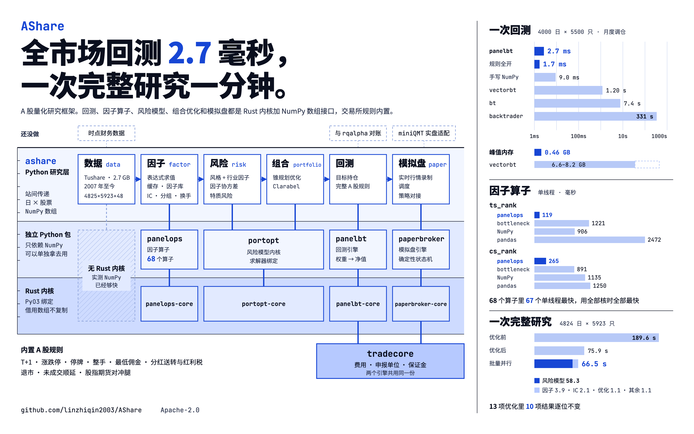
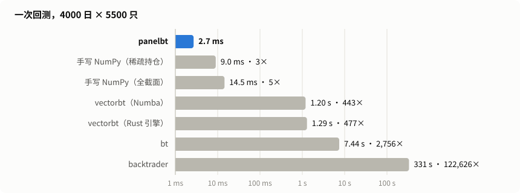
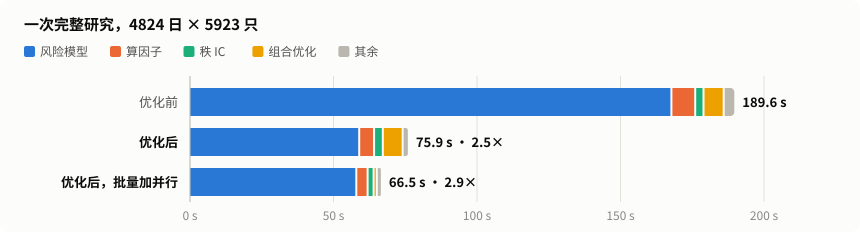

# AShare

A 股量化研究框架。回测、因子算子、风险模型、组合优化和模拟盘都是 Rust 内核加 NumPy 数组接口，交易所规则（T+1、涨跌停、停牌、整手、分红送转、退市）内置。

[English](README.en.md)



下面每个数字都出自仓库里的记录，可以重跑。测量机器是一台 Apple M5 Pro 笔记本。

## 为什么选它

### 全市场回测只要几毫秒



4000 个交易日 × 5500 只股票，约 100 只持仓，只收比例佣金。各引擎拿到的输入相同；除标注的以外，逐日净值相差不超过 1e-9。

| 引擎 | 每月调仓 | 加整手和现金缩减 | 每日调仓 |
|---|---:|---:|---:|
| **panelbt**（本仓库） | **2.7 ms** | **2.5 ms** | **27.6 ms** |
| 手写 NumPy 逐日循环，稀疏持仓 | 9.0 ms | 8.0 ms | 80.7 ms |
| 手写 NumPy 逐日循环，全截面 | 14.5 ms | 14.2 ms | 191 ms |
| vectorbt（Numba） | 1.20 s | 0.99 s | 2.82 s |
| vectorbt（Rust 引擎） | 1.29 s | — | 1.70 s |
| bt | 7.4 s ¹ | 3.6 s | 44.8 s ¹ |
| backtrader | 331 s | 278 s | 336 s |

¹ 费用按该引擎自己的分配模型近似。— 表示该引擎跑不了这个场景。

- `panelbt` 默认逐格检查输入（非有限的价格、互相矛盾的掩码、非法目标）。上面的手写 NumPy 循环不做任何检查。两边都带同一套检查时，完整跑一次是 8.0 ms 对 14.8 ms。
- 第一个场景的峰值内存（含约 0.45 GB 的输入面板）：`panelbt` 0.46 GB，bt 2.6 GB，backtrader 2.9 GB，vectorbt 6.6–8.2 GB。
- 完整 A 股规则（涨跌停、停牌、T+1、最低佣金、分红送转及红利税、退市、未成交顺延）在同一面板上约 1.7 ms，加上股指期货对冲腿是 3.5 ms。上面几个第三方引擎表达不了这组规则，所以这一项没有同口径的对比数字。

### 因子算子单线程就比 bottleneck 快

68 个时序、截面和逐元素算子，面板 4000 × 5500（窗口 20，缺失 5%）。单位毫秒，越小越好；粗体是单线程最快和总体最快的一格。

| 算子 | panelops 单线程 | panelops 全部核 | bottleneck | NumPy | Polars 全部核 | pandas |
|---|---:|---:|---:|---:|---:|---:|
| `ts_rank` | **119** | **19** | 1,221 | 906 | 320 | 2,472 |
| `ts_min` | **80** | **15** | 174 | 415 | 116 | 353 |
| `ts_std` | 80 | **16** | **76** | 457 | 113 | 307 |
| `ts_corr` | **339** | **40** | 524 | 703 | 298 | 456 |
| `ts_median` | **467** | **61** | 558 | 2,930 | 297 | 2,456 |
| `cs_rank` | **265** | **27** | 891 | 1,135 | 296 | 1,250 |
| `cs_neutralize` | **312** | **46** | — | 3,396 | — | — |
| `rank_ic` | **517** | **56** | 1,846 | 2,381 | 645 | 2,878 |

- 单线程下，68 个算子里有 67 个 `panelops` 比 NumPy、bottleneck 和单线程 Polars 都快，剩下一个慢不到 10%。
- 用默认线程数时，68 个算子全部快于各个库的默认配置。
- 滑动求和、均值、方差用精确有理数参考来核对；精度保护要花几个百分点的时间，没有为了速度删掉。

### 一次完整研究约一分钟



在真实数据上跑一遍（4824 个交易日 × 5923 只股票）：算 95 个因子和它们的秩 IC，对最好的一个做全套检验，重建全历史的基本面风险模型，据此优化 61 个月末的组合，再按完整 A 股规则回测。

| | 总耗时 | 95 个因子 | 秩 IC | 风险模型 | 61 期优化 |
|---|---:|---:|---:|---:|---:|
| 优化前 | 189.6 s | 8.3 | 2.9 | 168.1 | 7.0 |
| 优化后，调用方式不变 | 75.9 s | 5.2 | 3.0 | 59.3 | 6.9 |
| 优化后，改用批量和并行入口 | 66.5 s | 3.9 | 2.1 | 58.3 | 1.1 |

这一轮共 13 项改动，每项一个提交，都不许改变结果：

- 10 项与被替换的代码逐位相同。把风险模型的增量特质风险关掉后，整次研究的输出与优化前逐位相同。
- 增量特质风险是唯一带容差的一项：相对从头算 1e-12，实测 1.5e-14，并用 50 位精度的参照核对过。
- 各期互不依赖时并行求解，得到的权重同样最优但不逐位相同，所以是显式选项，默认仍然串行。表里最后两行的结果只差在这一处。
- 有一项试过没有可测的收益，已撤回，和做成的各项记在一起。

### 它不占优的地方

- 1000 组小回测（1000 日 × 100 只，15 线程）：`panelbt` 56 ms，NumPy 整块近似 53 ms。Rust 内核的优势在全市场规模和真实交易规则上，小面板上没有。
- 简化的期货对冲任务：手写 NumPy 0.56 ms，`panelbt` 1.0 ms。
- `ts_std` 单线程比 bottleneck 慢 6%。
- 风险模型的截面回归在单线程下：NumPy 的 Gram 解法 3.0 s，Rust 内核 5.0 s；开多线程后 Rust 更快（15 线程 0.64 s）。
- 单次组合求解不管怎么调用都是同一个 Clarabel 求解器，内核在这里没有额外收益。

### 这些数字靠什么守住

- 1395 个测试。回测内核与一份结构独立的纯 Python 参考实现、一份独立账本在几万组随机场景上对拍。
- 数据层的公司行为与交易所复权因子在全历史上对账：53,487 个事件，0 个对不上。
- 每一块工作都经过一次专门挑错的独立复核（副本试验、对抗输入、变异检查），查出的问题修完才合并。

## 仓库里有什么

| 包 | 做什么 |
|---|---|
| [`panelbt`](packages/panelbt/) | 日频组合回测内核：输入目标权重或股数，输出净值、成交和诊断。与市场无关，自带 A 股配置。 |
| [`panelops`](packages/panelops/) | 因子研究用的面板算子和因子检验（IC、分组收益、换手）。 |
| [`portopt`](packages/portopt/) | 风险模型内核和锥规划求解器绑定。 |
| [`paperbroker`](packages/paperbroker/) | 确定性的模拟盘引擎：订单、撮合、账户、结算。 |
| [`src/ashare`](src/ashare/) | 研究层：Tushare 数据仓库与时点面板、因子表达式与缓存、基本面风险模型、组合构建、回测报告、模拟盘。 |

四个包只依赖 NumPy，不导入 `ashare`。设计说明在 [docs/DESIGN.md](docs/DESIGN.md)。

## 快速开始

需要 Python 3.13、[uv](https://docs.astral.sh/uv/) 和稳定版 Rust 工具链。

```bash
make dev      # 把 Rust 扩展编译进工作区环境
make check    # 代码检查和全部测试
```

一次回测：

```python
import numpy as np
import panelbt as bt

prices = np.array([[10.0, 20.0], [11.0, 19.0], [12.0, 21.0]])
market = bt.Market(prices, prices, prices > 0, prices > 0)
targets = bt.Targets.from_dense([[0.5, 0.5], [np.nan, np.nan], [0, 0]])
costs = bt.Costs(commission_rate=0, commission_min=0,
                 fee_rate_buy=0, fee_rate_sell=0, slippage=0)
config = bt.Config(initial_cash=1000, min_qty=0, qty_step=0)
bt.run(market, targets, costs, config).nav      # [1.0, 1.025, 1.125]
```

一个因子和它的秩 IC：

```python
import numpy as np
import panelops

rng = np.random.default_rng(0)
close = 10 * np.exp(np.cumsum(rng.normal(0, 0.02, (500, 300)), axis=0))  # 日 × 股票
ret = close[1:] / close[:-1] - 1
momentum = panelops.cs_rank(panelops.ts_mean(ret, window=20))
forward = np.vstack([ret[1:], np.full((1, 300), np.nan)])                # 下一日收益
ic = panelops.rank_ic(momentum, forward)                                 # 每天一个值
```

回测完出一份报告（自包含的 HTML，离线可打开，可直接打印成 A4 PDF；需 `Config(record_trades=True)`）：

```python
import ashare.data, ashare.report

ashare.report.tearsheet(result, market, targets, dates, symbols,
                        data=ashare.data.open(), benchmark="000300.SH",
                        benchmark_kind="price").save("report.html")
```

指标口径见 [docs/REPORT_NOTES.md](docs/REPORT_NOTES.md)。

目标在给定的那一行成交：引擎不做信号移位。信号日与成交日的错位只在 `ashare` 里统一处理一次。

## 数据

仓库不含任何行情数据。数据层用你自己的 [Tushare](https://tushare.pro) 密钥下载（读环境变量 `TUSHARE_TOKEN`），全部存在不入库的 `data/` 下。Tushare 数据受其条款约束，这里不再分发。

## 状态

项目还早，变化快：接口可能改，也还没有发布到 PyPI。这是研究软件，不会下真实订单，其中任何内容都不构成投资建议。

## 许可证

[Apache-2.0](LICENSE)。
